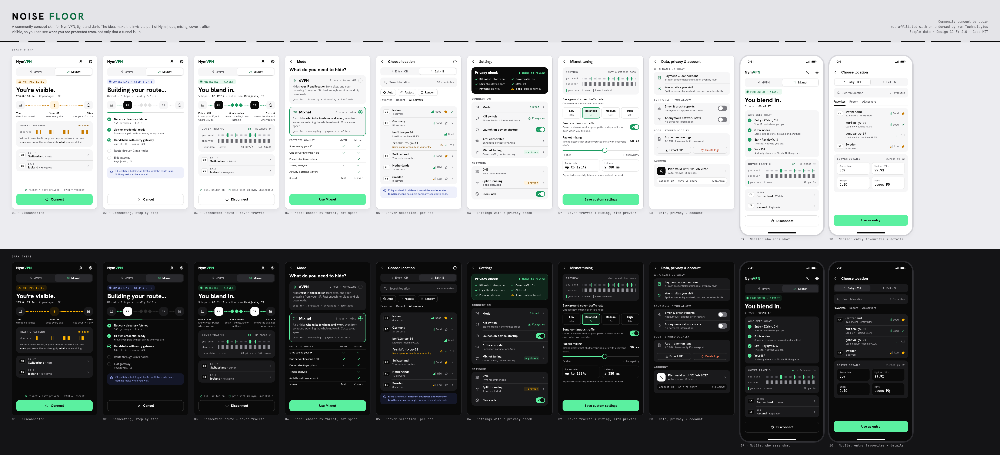

# Noise Floor: a NymVPN skin (light + dark)

A community concept skin for NymVPN by **apeir**, made for the Nym Squad League mission
"Skin NymVPN". It is **not affiliated with or endorsed by Nym Technologies**; nothing here is
official. All data on the screens is sample data.



## The idea in one line

Most VPN apps tell you *that* a tunnel is up. Nym protects more than that (metadata, timing, activity
patterns), but that part is invisible, so users can't see what they are getting or what they lose when
they switch mode or change a setting. **Noise Floor makes the invisible part visible**: the hops, what
each hop can know, and the cover traffic that makes you blend in.

## Screens

Desktop window 400×720 and mobile 390×844, each in light and dark (`renders/`, 2× PNG).

| # | Screen | What it shows |
|---|---|---|
| 01 | Disconnected | "You're visible.": your public IP and city, a route diagram of you → ISP → sites with what each one sees, and the bursty traffic pattern an observer sees without cover traffic. Entry/exit rows, Connect. |
| 02 | Connecting | Five real steps instead of a spinner: directory fetched, zk-nym credential ready, entry handshake, mix route, exit. The route lights up hop by hop. A note that the kill switch holds traffic meanwhile. |
| 03 | Connected (Mixnet) | "You blend in.": 5-hop route with one line per hop on what it knows ("knows your IP, not where you go"); cover-traffic card with a live packet tape of what you send (your data vs cover) next to what an observer sees (identical bars, steady rate); entry/exit; kill switch and zk-nym facts. |
| 04 | Mode | dVPN vs Mixnet chosen by *what you need to hide*, with a "protects against" table (IP, single point of knowledge, packet-size fingerprints, timing analysis, activity patterns, speed). |
| 05 | Server selection | Entry/Exit as numbered hops, search, Auto / Fastest / Random, Favorites / Recent / All servers, per-country performance (Good / Mid / Low, shown with bars **and** words), expandable server rows with load and uptime, an inline "same operator family as your entry" warning, and "your entry country" on the exit list. |
| 06 | Settings | A **Privacy check** summary at the top (kill switch, cover traffic, logs, stats, payment, apps outside the tunnel), then grouped settings. Settings that change privacy carry a `+ privacy` / `− privacy` tag. |
| 07 | Mixnet tuning | Cover-traffic rate (Low / Balanced 5× / Medium 10× / High 20×), continuous traffic, packet-mixing delay, expected packet rate and latency, with a preview of what a watcher sees. |
| 08 | Data, privacy & account | "Who can link what" (payment ↔ connections via zk-nyms; you ↔ sites split across entry and exit), opt-in telemetry, local logs with export/delete, plan and account ID. |
| 09 | Mobile: connected | The connected state with an expanded "who sees what" list (entry, mixes, exit, your ISP). |
| 10 | Mobile: server selection | Entry favourites with server details (load, 24 h uptime, QUIC bridge, post-quantum keys). |

## Design decisions

**1. The brand's noise line becomes an instrument.** nym.com uses a dashed, glitchy horizontal line as its
signature graphic. Here it does a job: it is the link between hops in the route diagram, and it
is the **packet tape** in the cover-traffic card. Tall brand-green bars are your data, short grey bars
are cover packets, and the "observer" row underneath is a run of identical bars. That pair answers the
question "what does cover traffic do for me?" without a paragraph of text. When disconnected, the
observer row turns into bursts and silences, which is what anyone on your network sees without it.

**2. Status is a sentence, then evidence.** Each state leads with a plain-language headline ("You're
visible." / "Building your route…" / "You blend in."), a mono badge (`NOT PROTECTED`, `CONNECTING ·
STEP 3 OF 5`, `PROTECTED · MIXNET`, echoing the mono "Unprotected by NymVPN" bar on nym.com), and then
the evidence: hops, timer, which country sites see.

**3. Every hop says what it can know.** The two-hop and five-hop designs are Nym's core idea, so the
route diagram has a caption for each hop. Users learn the model by using the app.

**4. Modes are chosen by threat, not by speed.** The toggle stays one tap on the home screen (as in the
current app). The Mode screen explains the trade in terms of what each mode protects against.

**5. Privacy cost is labelled where you make the choice.** Split tunneling is useful, but it takes apps out
of the tunnel; the settings list says so (`− privacy`), and the Privacy check counts it as "1 thing to
review". Mixnet tuning is tagged `+ privacy`.

**6. Server choice nudges toward independence.** Entry and exit are numbered hops (1, 2). The exit list
marks your entry country, and server rows warn when an exit shares an operator family with your entry
(the app already raises this warning in a dialog; here it shows up before you pick).

**7. Implementable.** Colours are the app's own `Brand_palette_v2` semantic tokens (from
`nym-vpn-app/src/styles.css`: forest green `#1a9b61` / mint `#5bf0a0`, `#0a0a0a` / `#ffffff`
surfaces, the same text and status rungs). Labels and copy reuse the app's own strings wherever
possible (dVPN, Mixnet, Entry, Exit, Auto, Random, Fastest, Favorites, Recent, All servers, Kill switch,
Enhanced connection, Mixnet tuning, Background cover traffic rate, Send continuous traffic, Packet
mixing, Logs (stored locally)…). Everything is plain HTML/CSS with tokens, so it maps to the existing
Tailwind setup.

## What exists today vs. what is proposed

Built on features the app has today (per the `nym-vpn-client` source): dVPN / Mixnet modes, entry and exit
selection with search, Favorites / Recent / All, Auto / Random / Fastest, performance score from load
and uptime, operator-family warning, kill switch (always on, desktop), launch on startup,
anti-censorship (Enhanced connection, QUIC), DNS, ad blocking, split tunneling, Mixnet tuning (cover
rate, continuous traffic, mixing delay, expected rate and latency), opt-in crash reports and stats,
local logs with export and delete, zk-nym credentials, account status.

**Proposals** (new UI, some need small daemon support):

- route diagram with per-hop "what it knows" captions;
- live packet tape and counters (pkt/s, % cover) on the home screen. This needs the daemon to expose
  real vs cover packet counters; the tape is a visualisation of that ratio, not a packet capture;
- step-by-step connecting progress (maps to tunnel-state phases; the exact step names may differ);
- Privacy check summary and `± privacy` tags in settings;
- threat-based mode screen with a comparison table;
- inline operator-family warning in the server list, "your entry country" marker;
- "Who can link what" section on the privacy screen.

The numbers on screen (IP `203.0.113.54` from the documentation range, server names, counts, latency,
packet rate, 50 ms) are illustrative.

## Accessibility

- All text was checked against WCAG 2.1 AA (4.5:1, or 3:1 for large text) in both themes by
  `render.cjs`, which measures every visible text node against its actual background. Current result:
  **all text passes**.
- Where a brand colour is too light for small text, a darker twin is used for text only and the brand
  value is kept for shapes. In light mode, green text uses `#0f6e42` (the palette's own
  `brand-primary-active`) instead of `#1a9b61` (3.4:1), tertiary text uses `#6b6b71` instead of
  `#8b8b90`, and amber/red text are darkened. In dark mode, info text uses a lighter blue.
- The primary button is mint with near-black text in both themes, as on nym.com (high contrast),
  instead of white on forest green (3.4:1).
- State is never colour-only: packet types differ in **height**, performance has bars **and** a word,
  toggles show a tick when on, off-toggle tracks meet 3:1 against their card, and every state badge has
  text and an icon.
- Packet tapes have `role="img"` and descriptive labels, and the animation stops under
  `prefers-reduced-motion`.

## Brand notes

- **Type:** Nym's current brand face is Lab Grotesque (+ Lab Grotesque Mono), a commercial font. This
  skin uses open substitutes with a similar feel: **Hanken Grotesk** (UI) and **JetBrains Mono**
  (data, badges), both SIL OFL 1.1, bundled in `fonts/`. An implementation would switch back to Lab
  Grotesque, which the app already ships.
- **Logo:** the Nym logo is **not** used. The app bar shows a plain text wordmark "NymVPN" set in the
  substitute font. In a real build it would be replaced by the official logo per Nym's rules.
- **Visual language followed:** black/white surfaces with mint/forest green as the only accent,
  wide-tracked uppercase section labels, mono for data and status, the dashed noise line.
- **Unverified:** the brand guidelines PDF linked from Nym's press kit is from 2021 (orange gradient, Open
  Sans) and predates the current green identity. I could not find a published current guide or
  community logo-use rules, so I relied on the app's palette tokens, nym.com and the 2025 press kit.
- Icons are drawn for this skin (inline SVG, 24 px grid, `index.html`). Nothing is loaded from Nym's
  servers.

## How to view

Open `index.html` in a browser. All screens are shown in a light row and a dark row, and the packet tapes
animate. Add `?static` to freeze them, or `?theme=dark` / `?theme=light` to show one row. No build step and
no network needed; fonts are local.

To re-render the PNGs and run the contrast check:

```bash
npm i -D playwright && npx playwright install chromium
node render.cjs        # writes renders/*.png and prints the WCAG check
```

## Files

```
index.html     all screens (template) + icon set
skin.css       tokens (light/dark) and components
skin.js        builds the light/dark rows, draws noise lines and packet tapes
render.cjs     Playwright: PNG per screen/theme at 2×, board.png, contrast audit
renders/       01…10 × light/dark PNGs, board.png
fonts/         Hanken Grotesk, JetBrains Mono (OFL)
```

## License

Design: CC BY 4.0. Code: MIT. Fonts: SIL OFL 1.1. See `LICENSE`.
